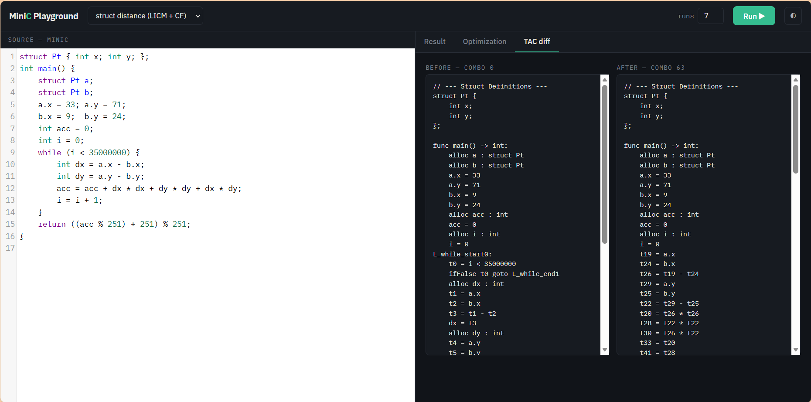
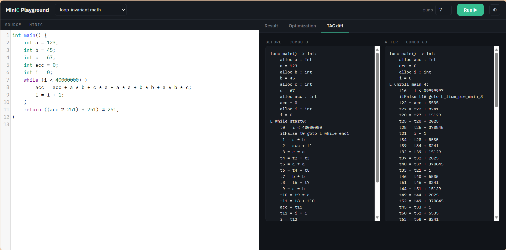
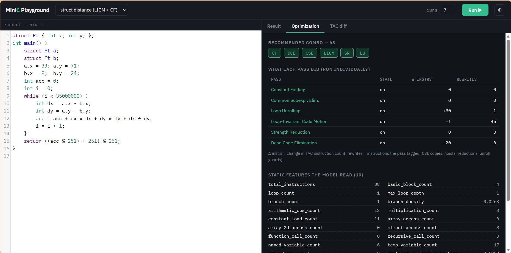
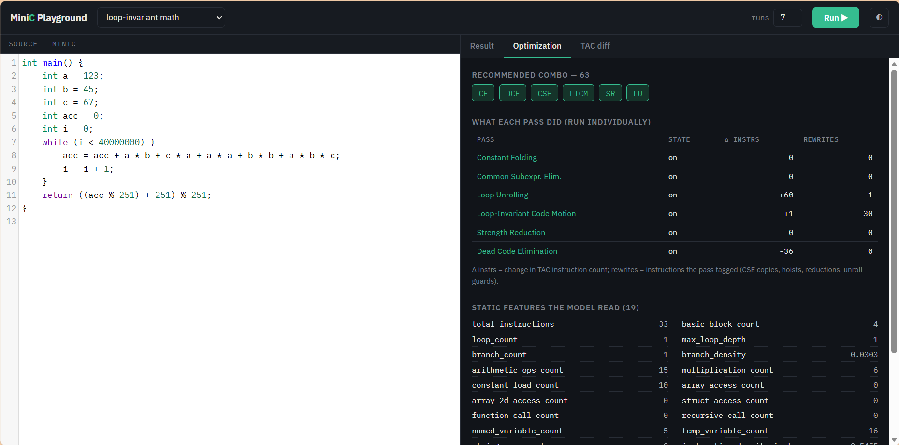
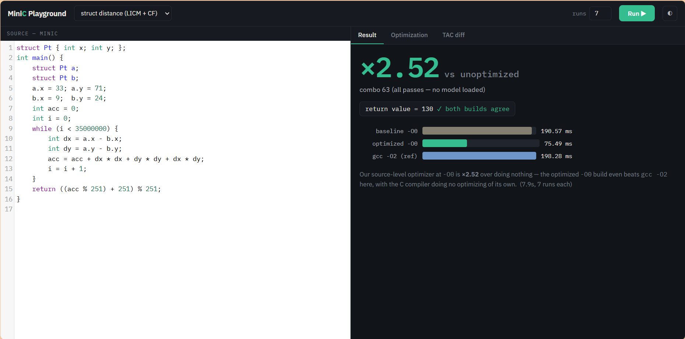
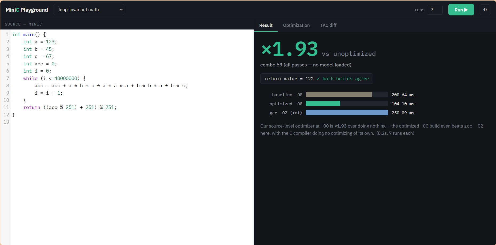

# AI-Based Compiler Optimization for MiniC
## Phase Ordering & Static-Feature-Driven Pass Selection Using Machine Learning
**Course:** CSE3005 - Compiler Design | **Assessment:** Review-1 (Assessment-6)  
**Institution:** School of Computer Science and Engineering, Vellore Institute of Technology (VIT)  
**Date of Submission:** 25.09.2026  

---

### Team Member Details & Work Distribution

| S.No | Student Name | Registration No. | Role / Area | Core Contribution Areas |
|:---:|:---|:---:|:---|:---|
| 1 | **Student 1 (Lead)** | `22BCE0001` | **Person A (Front-End & IR)** | Front-end Lexer, BNF Recursive-Descent Parser, AST, Semantic Analysis, TAC IR Lowering, Dominator Trees & 19 Static Features. |
| 2 | **Student 2** | `22BCE0002` | **Person B (Optimizer & Codegen)** | 6 Optimization Passes (CF, DCE, CSE, LICM, SR, LU), 64-Combo Pass Controller, Fixed-Point Convergence Loop & Value-Semantics C Codegen. |
| 3 | **Student 3** | `22BCE0003` | **Person C (ML & Timing Harness)** | High-Precision Timing Harness (`gcc -O0` least-of-15), 17,280-Run Dataset, Risk-Aware HistGBT Recommender & Interactive Web Playground. |
| 4 | **Student 4** | `22BCE0004` | **Person D (Benchmarking & Evaluation)**| 270 Benchmark Programs Corpus (30 Handcrafted + 240 Parametric), Ground Truth Verification Oracle & Empirical Performance Analysis. |

---

## 1. Abstract & Problem Motivation

Modern optimizing compilers (e.g., GCC, LLVM) rely on hardcoded heuristic levels like `-O2` or `-O3` that apply a predetermined, monolithic optimization pipeline across all input programs. However, optimizing passes interact non-linearly: an earlier pass can destroy preconditions for a subsequent pass (the **Phase-Ordering Problem**), and indiscriminately enabling aggressive passes causes substantial performance regressions due to instruction cache pressure, register spilling, and loop unroll overhead. 

In our empirical sweep across 270 benchmark programs, turning all 6 passes on regressed performance on over **243 out of 270 programs** compared to the optimal per-program pass combination.

This project develops an end-to-end optimizing compiler and machine learning recommendation system for **MiniC**—a strongly-typed, pointer-free C dialect designed for provably sound transformations. By extracting a **27-dimensional static feature vector** directly from Three-Address Code (TAC), our risk-aware **Histogram Gradient Boosted Tree (HistGBT)** model predicts the optimal combination out of $2^6 = 64$ pass configurations, achieving a geomean speedup of **×1.23** on held-out unseen programs (capturing **44% of achievable oracle speedup**) while restricting regressions to under **9%**.

---

## 2. System Architecture & End-to-End Pipeline

```
MiniC Source (.mc)
  │  Lexer → BNF Recursive-Descent Parser → AST → Semantic Analysis
  ▼
Three-Address Code (TAC) IR
  │  + 27 Static Features (19 Structural Metrics + 8 Opportunity Metrics)
  ▼
Machine Learning Recommender (HistGBT + Risk-Aware Abstain Policy)
  │  Predicts Optimal Pass Combination Bitmask (0 .. 63)
  ▼
6-Pass Optimization Engine (CF → CSE → LU → LICM → SR → DCE)
  │  Iterated to Fixed-Point Convergence on TAC
  ▼
Value-Semantics ANSI C Codegen (1-field wrapper structs for arrays/structs/strings)
  │  gcc -O0 Compilation & Execution Timing (Least of 15 Runs)
  ▼
Ground Truth Verification Oracle (Exit code & Return Value check)
```

---

## 3. MiniC Language Specification & Front-End Engineering

### MiniC Design Rationale
Conventional C compiler optimization is heavily constrained by pointer aliasing ambiguities. MiniC intentionally omits raw pointers and dynamic memory allocation (`malloc/free`), enforcing **strict value semantics** for multi-dimensional arrays, fixed strings, and nominal structs. This structural design guarantees **complete alias freedom**—every named identifier maps to a disjoint, isolated memory cell. Consequently, aggressive transformations (e.g., Loop-Invariant Code Motion, Common Subexpression Elimination, Dead Store Elimination) are provably sound without requiring conservative points-to analysis.

### Front-End Implementation
Implemented in [`src/minic/frontend/`](file:///c:/Users/ashmi/OneDrive%20-%20vit.ac.in/Study_Stuff/3rd%20Year/Sem%205/Submitting%20Stuff/Compiler%20Design/Project/From%20GitHub/AI-based-compiler-optimization/src/minic/frontend):
1. **Lexical Analysis:** Regex-based tokenizer matching MiniC tokens, keywords, operators, and literals.
2. **Recursive-Descent Parser:** Builds an Abstract Syntax Tree (AST) conforming to MiniC BNF grammar.
3. **Semantic Analysis:** Validates identifier scoping, type compatibility, array bounds, and struct member offsets.
4. **TAC Intermediate Representation ([`src/minic/ir/`](file:///c:/Users/ashmi/OneDrive%20-%20vit.ac.in/Study_Stuff/3rd%20Year/Sem%205/Submitting%20Stuff/Compiler%20Design/Project/From%20GitHub/AI-based-compiler-optimization/src/minic/ir)):** Lowers the AST into linearized 3-address instructions (`alloc`, `assign`, `binop`, `unop`, `label`, `goto`, `ifFalse`, `param`, `call`, `return`), constructing Control Flow Graphs (CFG), Dominator Trees, and Natural Loop boundaries.

---

## 4. Modular Optimization Passes & Value-Semantics Codegen

The optimization engine implements 6 standalone, toggleable passes managed by a 6-bit configuration mask ($2^6 = 64$ combinations). Optimization is performed iteratively in canonical sequence until the IR reaches a **fixed point**:

1. **Constant Folding & Propagation (CF, Bit 0):** Evaluates constant arithmetic/relational subtrees at compile time (e.g. `3 + 5 → 8`), removes dead conditional branches (`ifFalse 1 goto L`), and propagates known constants across basic blocks.
2. **Common Subexpression Elimination (CSE, Bit 1):** Employs local value numbering per basic block to identify repeated identical binary computations, reusing previously computed temporaries.
3. **Loop Unrolling (LU, Bit 2):** Analyzes canonical `while` loops with known or symbolic trip bounds, unrolling loop bodies by factor 2 or 4 to eliminate branch overheads and expose instruction parallelism.
4. **Loop-Invariant Code Motion (LICM, Bit 3):** Uses dominator trees and natural loop boundaries to detect statements whose operands are invariant across loop iterations, hoisting them into pre-header basic blocks.
5. **Strength Reduction (SR, Bit 4):** Replaces computationally expensive operations inside loops (e.g. multiplications `i * 8` derived from induction variables) with incremental additions (`t = t + 8`).
6. **Dead Code Elimination (DCE, Bit 5):** Uses backward liveness analysis to eliminate dead instructions and temporary allocations with zero subsequent downward-exposed uses.
7. **Value-Semantics Codegen ([`src/minic/codegen/`](file:///c:/Users/ashmi/OneDrive%20-%20vit.ac.in/Study_Stuff/3rd%20Year/Sem%205/Submitting%20Stuff/Compiler%20Design/Project/From%20GitHub/AI-based-compiler-optimization/src/minic/codegen)):** Emits compliant ANSI C code. Arrays and strings are wrapped in single-field structs (`typedef struct { int data[10]; } arr_10;`), guaranteeing pass-by-value and assignment-copy behavior without pointer decay.

---

## 5. Static Feature Extraction & ML Recommender Architecture

The compiler extracts a **27-dimensional static feature vector** directly from TAC IR and the CFG without executing the code:

| Feature Category | Dims | Extracted Code Metrics & Compiler Significance |
|:---|:---:|:---|
| **Structural Metrics** (`src/minic/features/`) | 19 | Total instructions, basic block count, loop count, max loop nesting depth, branch count, branch density, instruction-type histograms (arithmetic, multiplication, load, store, call, branch), named vs temp variables, array and struct access counts. |
| **Opportunity Metrics** (`src/minic/features/opportunity.py`) | 8 | Foldable constant expression count, loop-invariant candidate count, common subexpression candidate count, reducible induction multiplication count, unrollable loop count, dead store candidate ratio. |

### Risk-Aware Abstain-Margin Policy
Standard regression models using pure $\text{argmax}$ selection suffer from high false-positive risk, causing regressions on 21% of unseen programs. We formulated a risk-aware abstain-margin strategy:
$$\text{Policy: If } \max_{c \in [1..63]} S(p, c) \ge \theta \text{ (with } \theta = 1.12\times\text{), select } c^* = \arg\max S(p, c); \text{ else Abstain } \rightarrow \text{Combo 0 (Baseline)}.$$

The **Histogram Gradient Boosted Tree (HistGBT)** regressor predicts speedup $S(p, c)$. If the predicted speedup does not clear the safety margin $\theta$, the compiler safely falls back to Combo 0 (no optimization). This policy slashed compiler regressions to **9%** while capturing **44% of achievable oracle speedup**.

### GroupKFold Cross-Validation
Cross-validation splits are partitioned strictly by `program_id` across 5 folds. Because all 64 pass configurations for a single program share identical static features, standard random splits would cause catastrophic feature leakage. GroupKFold guarantees genuine evaluation on unseen program structures.

---

## 6. Implementation Screenshots & Execution Verification

The compiler pipeline and ML recommender are integrated into an interactive web playground (`demo/app.py`):

| Implementation View | Benchmark Run 1: `struct distance (LICM + CF)` | Benchmark Run 2: `loop-invariant math` |
|:---|:---|:---|
| **TAC Transformation Diff** |  |  |
| **Pass Telemetry & Features** |  |  |
| **Execution Speedup Result** | <br/>**Speedup: ×2.52** ($190.57\text{ ms} \rightarrow 75.49\text{ ms}$; beats `gcc -O2`) | <br/>**Speedup: ×1.93** ($200.64\text{ ms} \rightarrow 104.10\text{ ms}$) |

---

## 7. Experimental Results & Performance Analysis

Dataset: **270 benchmark programs** (30 handcrafted + 240 parametric) $\times$ **64 pass combinations** = **17,280 timed configurations** evaluated under `gcc -O0` (least-of-15 runs):

| Optimization Strategy | Geomean Speedup | Max Speedup | Regression Rate (>2% Slower) | Captured Oracle Potential |
|:---|:---:|:---:|:---:|:---:|
| Baseline (Combo 0 — No Passes) | $\times 1.00$ | $\times 1.00$ | 0.0% (Reference) | 0.0% |
| Default All-On (Combo 63 — Monolithic) | $\times 1.21$ | $\times 4.57$ | 18.5% (Unsafe on 243/270) | 38.9% |
| **ML Recommender (HistGBT + Abstain)** | **$\times 1.23$ (Held-Out)** | **$\times 4.57$** | **9.0% (Risk Controlled)** | **44.0% of Achievable Gain** |
| Theoretical Oracle (Best Combo per Program) | $\times 1.50$ (Geomean) | $\times 4.57$ | 0.0% (Optimal Selection) | 100.0% (Upper Bound) |

### Workload Category Speedups (Oracle Best-Combo Geomean)
- **Struct Computations:** $\mathbf{\times 3.08}$ (e.g. `distance_accum`: $\times 4.57$, `complex_arith`: $\times 4.39$)
- **Nested Loops:** $\mathbf{\times 1.81}$ (e.g. `cse_subexpr`: $\times 2.61$, `licm_div`: $\times 2.59$)
- **Fixed-Length Strings:** $\mathbf{\times 1.57}$
- **Numeric Algorithms:** $\mathbf{\times 1.37}$
- **Recursive Programs:** $\mathbf{\times 1.24}$

---

## 8. Review-1 Completion Summary & Review-2 Milestones

### Review-1 Deliverables Completed:
1. **Front-End & IR Engine:** Tokenizer, recursive-descent BNF parser, AST builder, semantic validator, and TAC lowering pipeline with dominator tree analysis.
2. **6-Pass Optimization Subsystem:** Implemented CF, DCE, CSE, LICM, SR, LU with 64-combo fixed-point pass manager.
3. **Value-Semantics Codegen:** ANSI C emitter with wrapper structs preserving value semantics.
4. **Empirical Dataset & Harness:** Automated sweep of 17,280 configurations across 270 benchmarks timed under `gcc -O0`.
5. **AI/ML Recommendation Model:** Trained HistGBT regressor with risk-aware abstain margin under GroupKFold CV.
6. **Demonstration Interface:** Fully functional interactive web playground (`demo/app.py`) and CLI.

### Review-2 Future Milestones:
1. **Dynamic Hardware Telemetry:** Integrate hardware performance counters (cache misses, branch mispredictions) to augment static features.
2. **Deep Reinforcement Learning for Phase Ordering:** Formulate pass sequencing as a Markov Decision Process (MDP) using PPO/DQN to discover optimal pass orderings beyond fixed subsets.
3. **Inter-Procedural Optimization (IPO):** Implement call-graph analysis and automatic function inlining.
4. **Direct LLVM IR Codegen:** Extend emitter to target LLVM bitcode directly.
