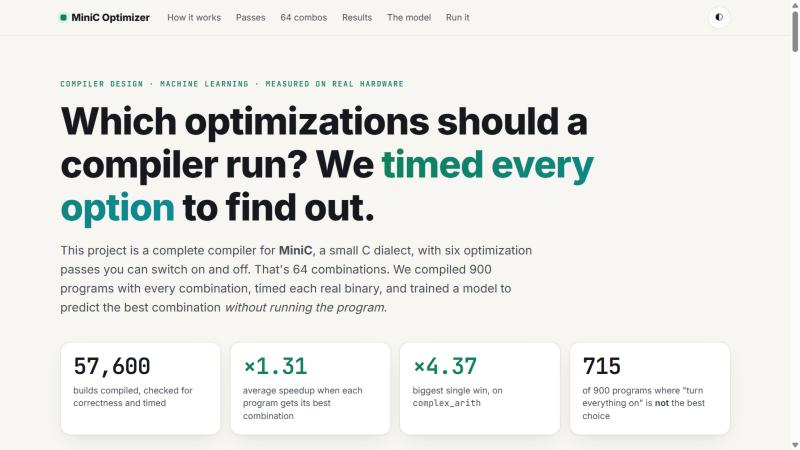
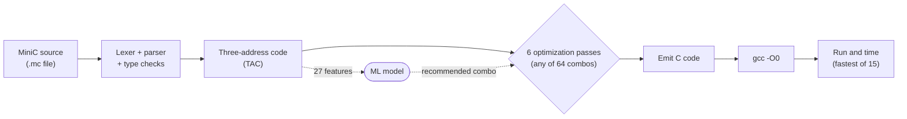
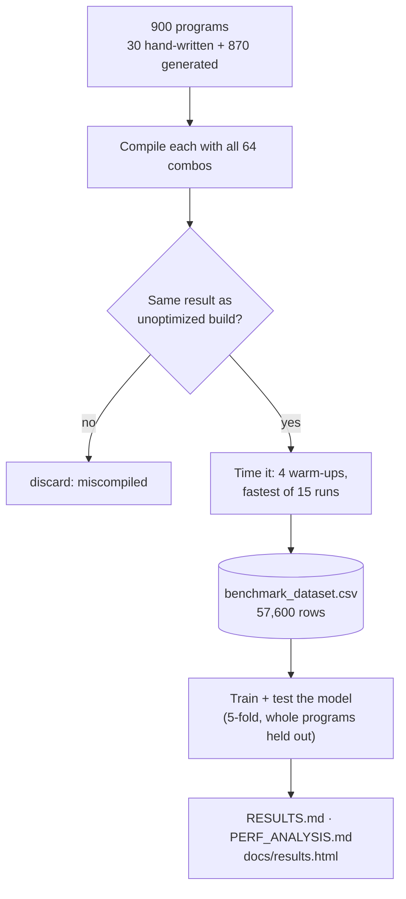
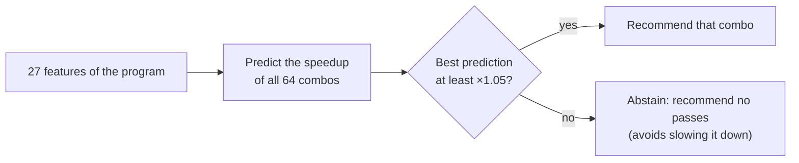
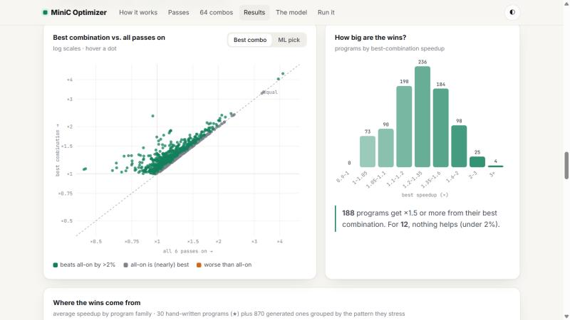
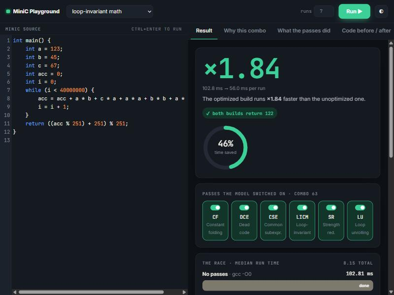
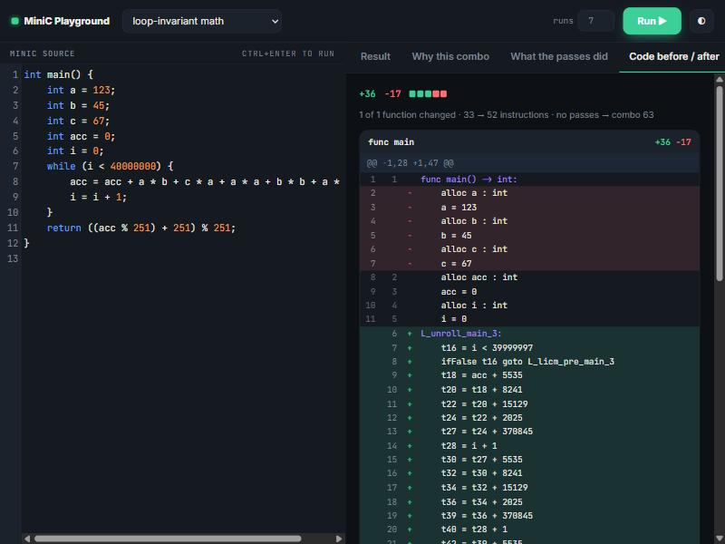

# AI-Based Compiler Optimization for MiniC

A complete compiler for **MiniC** (a small C dialect) with **six optimization passes** you can switch on and
off, plus a **machine-learning model that predicts which passes to switch on** for a given program, without
running it.

Every claim is checked on real hardware. We compiled 900 programs with all 64 combinations of passes
(**57,600 builds**), verified that each build still gives the right answer, and timed each one.

**Visual report:** [`docs/results.html`](docs/results.html). Download and open it in a browser (or run
`python minic.py results`) for animated, interactive charts of every result.



---

## The idea in one minute

Compilers speed up code with **optimization passes**: small rewrites like "compute this once instead of
three times" or "move this calculation out of the loop". Real compilers have hundreds of them, and the
usual choice is to turn on a fixed set (`-O2`, `-O3`).

But passes don't always help. Sometimes a pass makes a program slower, and passes affect each other. So
for each program, **which combination of passes is fastest?**

This project answers that question in three steps:

1. **Build a compiler** small enough to control completely: MiniC → three-address code → 6 optimization
   passes → C → `gcc -O0`. gcc's own optimizer is off, so any speedup comes from *our* passes.
2. **Measure everything.** Every program × every one of the 64 pass combinations, compiled, checked and
   timed. That gives the true best combination for each program.
3. **Train a model** that looks at a program's code (27 features like loop depth and repeated
   expressions) and predicts the best combination. That makes it usable on a new program without
   timing 64 builds.

## How it works

### The compiler pipeline



**Three-address code (TAC)** is a simple instruction list where every line does one operation
(`t1 = a * b`). It's easy to analyze and rewrite, which is why the passes work on it.

### The six passes

Each pass is one **bit** of a combination number. Add the values of the passes you want:

| Pass | Value | What it does | Example |
|---|--:|---|---|
| **CF** Constant folding | 1 | computes known values at compile time | `6 * 7` → `42` |
| **DCE** Dead-code elimination | 2 | deletes results nobody uses | unused `t3 = ...` removed |
| **CSE** Common subexpression elimination | 4 | computes a repeated expression once | `x*y + x*y` → `t = x*y; t + t` |
| **LICM** Loop-invariant code motion | 8 | moves unchanging work out of loops | `a * b` computed once, not 1,000,000 times |
| **SR** Strength reduction | 16 | swaps costly operations for cheap ones | `i * 4` → running `+ 4` |
| **LU** Loop unrolling | 32 | copies the loop body 4× to cut loop overhead | 4 iterations per loop test |

So combo `0` = no passes, `63` = all six (1+2+4+8+16+32), `9` = CF + LICM. The passes run in a fixed order
and repeat until the code stops changing.

### The experiment



### How the model makes a recommendation



## Results

| | |
|---|---|
| Best combination for each program (found by timing all 64) | **×1.31** average speedup, up to **×4.37** |
| All 6 passes on | **×1.19** average, but not the best choice for **715 of 900** programs, and **2.3× slower** than no optimization on the worst one |
| Every combination slows down at least one program | there is no safe fixed default |
| Effects of passes don't simply add up | multiplying single-pass speedups predicts ×1.10; measured ×1.19 |
| **ML model** (on programs it never saw, no timing needed) | **×1.21** average, slows **9%** of programs |
| All 6 passes, same measure | ×1.22 average, slows 12.4% of programs |

**Honest result:** the model roughly *matches* "turn everything on" in speed, while slowing fewer
programs and needing zero timing runs. It doesn't yet beat it. The best-possible ×1.33 shows there's
room left. Pass interactions, which simple code features don't capture well, are the main obstacle.



Details: [`RESULTS.md`](RESULTS.md) (every program) · [`PERF_ANALYSIS.md`](PERF_ANALYSIS.md) (per-pass
effects, interactions, timing noise) · [`MODEL_COMPARISON.md`](MODEL_COMPARISON.md) (8 models compared) ·
[`docs/WALKTHROUGH.md`](docs/WALKTHROUGH.md) (one program traced through every stage).

## Quick start

**1. Install the requirements**

- **Python 3.9 or newer**
- **gcc** on your PATH. MiniC compiles its output with gcc.
  - Windows: `winget install BrechtSanders.WinLibs.POSIX.UCRT`, then open a new terminal
  - macOS: `xcode-select --install`
  - Linux: `sudo apt install gcc`

**2. Install the Python packages and check your setup**

Create a virtual environment for the project (once), then activate it in every new terminal:

```bash
python -m venv .venv
```

```bash
.venv\Scripts\activate
```

(On macOS / Linux: `source .venv/bin/activate`.) Your prompt now starts with `(.venv)`. Then install the
packages:

```bash
pip install -r requirements.txt
```

```bash
python minic.py check
```

`check` verifies Python, the packages, gcc and the dataset, then compiles and runs a test program. If it
prints `All good.`, everything below works.

**3. Try it**

```bash
python minic.py compile canonical_example.mc --optimize 63 --run
```

```bash
python minic.py recommend benchmarks/loops/licm_arith.mc --verify
```

```bash
python minic.py playground
```

The first time you use `recommend` or the playground, the model trains itself from the included dataset.
That takes about 15 seconds, once.

The **playground** is a browser editor: write MiniC, press Run, and it shows the speedup and time saved,
the passes the model switched on, a timing race between the builds, the model's predictions for all 64
combinations, and a GitHub-style diff of the code before and after.

| Result | Code before / after |
|---|---|
|  |  |

## All commands

Run everything from the repository folder as `python minic.py <command>`. Add `--help` to any command for
its options.

| Command | What it does | Time |
|---|---|---|
| `check` | checks Python, packages, gcc and data; runs a smoke test | seconds |
| `compile FILE.mc` | compiles a MiniC file and prints its TAC | instant |
| `compile FILE.mc --optimize 63 --run` | applies passes (0–63), compiles with gcc and runs it | ~1 s |
| `compile FILE.mc --tree` / `--cfg` / `--features` / `--emit-c` | shows the syntax tree / control-flow graph / 27 features / generated C | instant |
| `recommend FILE.mc` | asks the model which passes to use | ~1 s |
| `recommend FILE.mc --verify` | …and times the program with and without them | ~5–30 s |
| `benchmark FILE.mc` | times the program with each pass alone and all together | ~10–60 s |
| `playground` | browser editor at http://127.0.0.1:5005: write MiniC, compare speeds | — |
| `results` | rebuilds `docs/results.html` from the dataset and opens it | seconds |
| `analyze` | rewrites `PERF_ANALYSIS.md` from the dataset | seconds |
| `experiment` | retrains and re-evaluates the model, rewrites `RESULTS.md` | ~4 min |
| `experiment --full` | re-times all 57,600 builds first (needs a quiet machine) | ~3.5 h |
| `experiment --compare-models` | also runs the 8-model comparison (needs `pip install -r requirements-models.txt`) | ~25 min |
| `test` / `test --quick` | runs the whole test suite / skips the 6 slow 64-combo tests | ~25 min / ~20 s |

## Write your own MiniC program

MiniC is C without pointers or dynamic memory: `int`, `float`, `char`, fixed-size 1D/2D arrays, structs,
strings, functions (including recursion), `if`/`else`, `while` and `for`. There's no I/O, so a program's
**return value** is its output (shown as `Program returned: N`). Keep it between 0 and 255, because it
becomes the process exit code.

```c
int main() {
    int total = 0;
    int i = 0;
    while (i < 1000000) {
        total = total + (i % 7) * 3;
        i = i + 1;
    }
    return total % 251;
}
```

Save it as `mine.mc`, then run:

```bash
python minic.py recommend mine.mc --verify
```

Full language reference: [`docs/spec/minic-language-spec.md`](docs/spec/minic-language-spec.md).

## Repository layout

```
minic.py                 the single entry point (python minic.py --help)
src/minic/
  frontend/              lexer, parser, semantic checks (types, scopes)
  ir/                    three-address code, control-flow graphs
  optimizer/             the 6 passes + pass manager (runs them to a fixed point)
  codegen/               TAC -> C
  features/              the 27 features the model reads
  harness/               gcc compile + timing, the 64-combo sweep, reports, results page
  ml/                    dataset, models, training, recommendation
demo/                    command-line tool (recommend / benchmark) and the browser playground
benchmarks/              30 hand-written programs + 870 generated ones (benchmarks/generated/)
data/                    benchmark_dataset.csv (all 57,600 timings); the trained model is created locally
docs/                    results page, walkthrough, language spec, team notes
reports/                 course reports (Review 1 / Final) and the scripts that generate them
tests/                   pytest suite
```

## Testing

```bash
python minic.py test --quick
```

```bash
python minic.py test
```

The full suite checks that **all 64 pass combinations** produce the same result as the unoptimized build
for every test program, along with the front end, IR, each pass, the timing harness and the ML plumbing.

## Notes

- **The trained model isn't committed.** Saved scikit-learn models only load with the library version that
  saved them, and the old random-forest model was 640 MB. Instead, a small gradient-boosting model (2 MB,
  same accuracy) is trained from `data/benchmark_dataset.csv` the first time it's needed.
- **Timings depend on the machine.** Re-running `experiment --full` on another computer gives somewhat
  different numbers, but the same overall picture.
- **Measured with an earlier compiler version.** The dataset was recorded before a fix to loop unrolling,
  which, combined with LICM, could unroll a loop twice. The extra copy never ran, so results were correct;
  it only made the generated code larger. See [`CHANGELOG.md`](CHANGELOG.md).

## Team

Four roles: front end / IR / features (A), optimization passes + code generation (B), timing harness + ML +
demo (C), benchmark programs (D). See [`docs/team/CONTRIBUTIONS.md`](docs/team/CONTRIBUTIONS.md).
